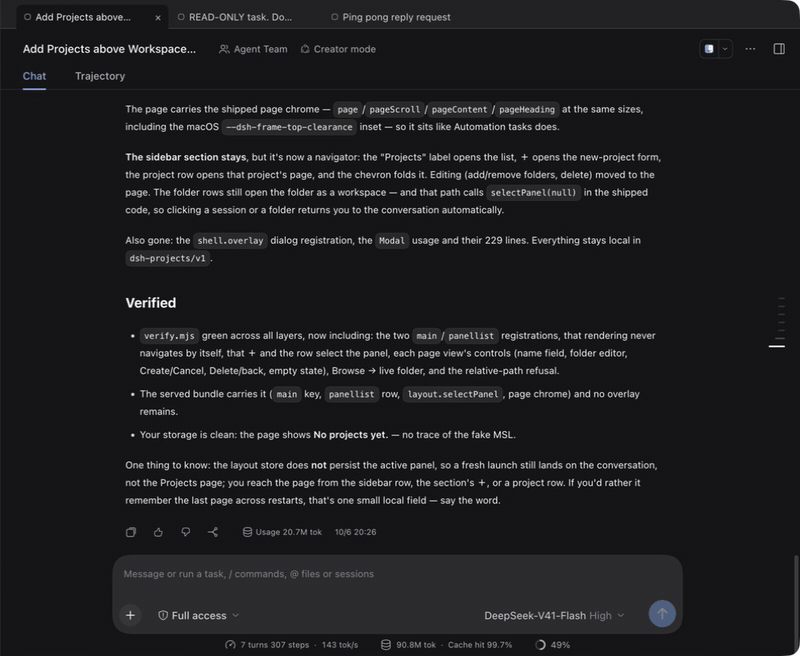

# DSH Session Tabs

A DeepSeek Harness desktop plugin that puts chat tabs at the top of the conversation panel.



## How tabs work

- Opening a chat gives it a preview tab. The next chat you open replaces the preview. Chats where you've sent a message keep their own tabs.
- Tabs stay in the order you first use them. Scroll sideways when the strip fills up. A green dot marks a running session.
- Click × to close a tab. You can reopen the chat from the sidebar. Right-click a tab to rename the session or close tabs to its left, right, or on both sides.
- Tab order and dismissals are saved locally across app restarts.

## Install

1. Quit DeepSeek Harness.
2. Add this entry to `dependencies` in `~/.dsh/profiles/desktop/package.json`:

   ```json
   "dsh-session-tabs": "github:rifkyazizf/dsh-session-tabs"
   ```

3. Install the dependency:

   ```sh
   cd ~/.dsh/profiles/desktop && pnpm install
   ```

4. Append this entry to `~/.dsh/profiles/desktop/cordis.patch.yml`:

   ```yaml
   - insert:
       - id: ui-session-tabs
         name: 'dsh-session-tabs'
   ```

5. Restart DeepSeek Harness.

Run `pnpm update dsh-session-tabs` from the desktop profile directory to update. To disable the plugin, remove its entry from `cordis.patch.yml` and restart. To uninstall it, also remove the dependency and run `pnpm install` again.

## Verify

Run `node verify.mjs` from the plugin directory.

## License

[MIT](LICENSE)
