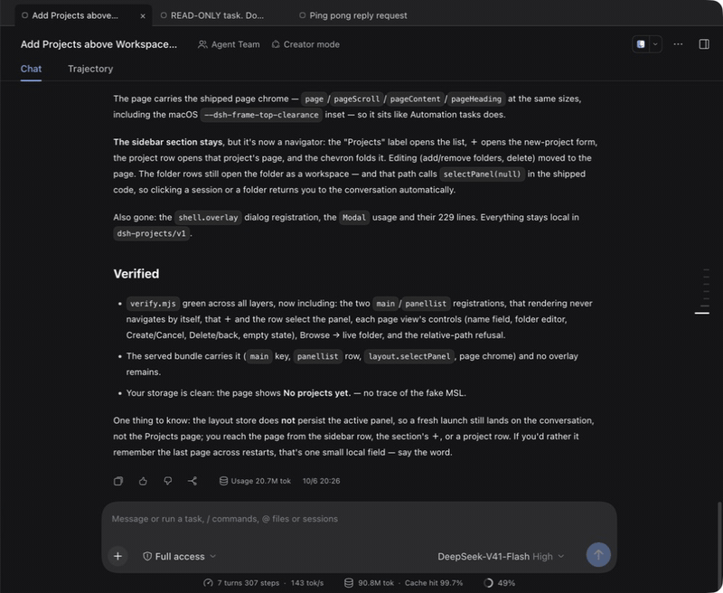

# dsh-session-tabs

JetBrains-style session tabs for the DSH Web GUI: one tab per chat session, in a
strip at the top of the conversation panel.



```
│ ● Add DeepSeek…  × │ ● Fix the login bug │ ● vendor sync │
```

A session you **sent a message in** keeps its tab. A session you merely
**opened** is one disposable tab that the next open replaces, so clicking
through the sidebar never leaves a trail of tabs.

## The rule

This is the editor-tab behaviour from JetBrains, with sessions in the role of
files:

| Session | Tab |
| --- | --- |
| You sent a message in it | An ordinary tab that stays |
| You only opened it | The single "preview" tab, replaced by the next open |

The stick signal is **not tracked by this plugin**. The session list already
carries it as `blank`:

> A blank session is the selected Workspace's provisional New Session row.

`blank === false` therefore means the session has real content. The host sets it
on the first accepted prompt (`promptAttempted`, set synchronously before the
first await) and its reducer deliberately refuses to re-blank a session
afterwards:

```js
handleBlank(blank) {
  if (blank === this.blankBit) return;
  if (blank && (this.promptAttempted || this.running)) return;  // sticky
  ...
}
```

So "sent a message" is the host's own durable notion of it, already computed and
already sticky. Delegating to it means the strip cannot disagree with the rest of
the UI about whether a session has been used, and there is no local bookkeeping
to drift or to persist.

Two properties follow, and both are tested:

- **Order is engagement order**, not recency. Revisiting an old tab does not
  reshuffle the strip under the pointer.
- **The preview is always last**, because it is the one that will be replaced.

Subagent sessions are excluded: they are reached through their parent's
breadcrumb rather than by switching the conversation, so a tab for one would
misrepresent what the strip does. Nothing is capped or recycled: every engaged
session keeps a tab in engagement order, and the row **scrolls sideways** when the
tabs outgrow it (plain wheel included), with the active tab kept in view.

## Placement — the first row of the conversation

The strip is **registered** in `conversation.input.dock` — a list seat above the
composer, shared with the todo, queue, and goal docks — and **drawn** in a row this
plugin anchors ahead of every row the conversation already has, so the tabs are the
first thing in the conversation:

```
div.root                            ← the conversation column (flex column)
├── div[data-session-tabs-host]     ← the strip's row (inserted by this plugin)
├── header                          ← title row + Chat/Trajectory view tabs
└── div[data-conversation-content]  ← transcript + composer
```

### Why it is not a seat

The app declares no seat above the conversation content:

- `conversation.header` is a **single** seat declared *and* occupied by the
  shipped `ui-conversation` plugin. A second registration at the same priority
  throws `single slot "conversation.header" already has a registration …`;
  registering at `apply` time — before the seat exists — throws
  `slot "conversation.header" is not declared`, which fails the plugin's whole
  fiber and aborts web boot.
- Its only unoccupied child, `conversation.header.leading`, sits *inside* the
  title bar (the window drag region), so it cannot hold a full-width row.
- The header's other children (`…session.header.actions`, `.utilities`) are narrow
  control clusters beside the title.

Placement is therefore done in the DOM: the dock registration supplies the seat
and the session props, and the component inserts a host row as the conversation
column's first child, then renders the strip into it with `createPortal` (the shell
exposes `react-dom` as a platform seed word, so a client bundle may require it).
The column is reached from the seat's own placeholder, so it is always the column
that seat belongs to. The host is re-anchored whenever it leaves the document, so a
re-render of the conversation column cannot strand the strip in a detached node.

The row sits outside the header's `data-window-drag` region, so chips click and
scroll normally; window dragging keeps the title row and the sidebar.

### Why the memory is the whole order, not the visible tabs

`stepTabs` returns the strip *and* the order to remember next, which is the full
engagement order — never the window that happened to be rendered. That looks like a
detail; it is the difference between a still strip and a rotating one:

| Remembered | What 6 re-renders of 10 engaged sessions show |
| --- | --- |
| the visible tabs (a window) | 5 distinct windows — the strip rotates on every re-render |
| the full engagement order | 1 window, unchanged |

Typing re-renders the strip constantly (the session store ticks), so a rotating
strip is exactly the flicker a user sees while typing. `verify.mjs` replays this
loop through `stepTabs` — the function the component calls — and fails if more than
one window appears.

### Why the memory is module state, not a ref

Switching sessions **remounts** the conversation Factory occurrence — its key carries
the session generation — so a ref dies the moment you open another session. A
dismissal kept in a ref therefore came back on the very next click elsewhere, and the
engagement order died with it, reshuffling the tabs on every switch. `dismissedTabs`
and `engagementOrder` are module state for that reason, and `verify.mjs` drives real
remounts (fresh refs, retained module memory) to assert both survive.

A page reload would still wipe them, and the shell reloads its page whenever the app
restarts, so the same memory is written to `localStorage` under
`dsh.session-tabs.v1` — the `dsh.<name>.v1` convention shipped client plugins use (the
conversation's transcript width, the right sidebar's layout) — and read back on load.
That key lives in the `dsh-app://app` origin, which the desktop registers as
`standard` + `secure`, so it survives restarts. A blocked store, a missing key, or a
corrupt payload all read as a cold start rather than an error, and the offline suite
covers the round trip, the payload validation, and a seeded "page load".


### The scrollbar is the shell's

The strip sets no `scrollbar-width`/`scrollbar-color`, on purpose. `ui-theme`
installs unscoped `::-webkit-scrollbar` rules (`--dsh-scrollbar-width` = 5px, a
rounded thumb in `--dsw-alias-scrollbar-bg-l1`, a hover colour from
`--dsw-alias-scrollbar-hover-l1`), so the bar matches the transcript's and the
sidebar's. Chromium **ignores** those rules for any element that sets the standard
properties, and the strip used to set `scrollbar-width: thin` — which is why it had a
fat native macOS bar while the rest of the app had a thin themed one. If a profile
disables `ui-theme`, the strip's bar goes native along with every other scrollbar.

### The frame is browser-style, and why the rail is paint

The strip is drawn as a browser tab strip rather than a row of chips: a bar a shade
off the pane's own surface, the tabs sitting on a hairline rail along its bottom,
and the active tab punched down to the pane colour so it reads as *connected* to the
row beneath it. The chip is 30px tall with 8px shoulders and square feet
(`borderRadius: "8px 8px 0 0"`) on a 36px bar.

Three things about how that is drawn are deliberate, and each was forced by how CSS
composites a scroller:

- **The bar's fill is a translucent neutral** (`rgba(127,127,127,0.12)`), not a
  surface token. The shell's surfaces are *raised above* the pane in dark mode —
  `--dsw-alias-bg-base` **is** the pane, and `--dsw-alias-bg-layer-1…3` are lighter
  than it — so no single surface token can be "a bar slightly off the pane" in both
  themes: one theme would erase the bar, the other would paint a raised card. A 12%
  neutral over the pane reads as a raised bar in the dark theme and a recessed one
  in the light theme, from one value.
- **The active chip is filled with `--dsw-alias-bg-base`** — the pane's own colour.
  That, not a border or a shadow, is what merges the tab into the row below.
- **The rail is the strip's bottom row of *background*, not a `border-bottom`.**
  A child cannot paint over its parent's border, and the strip clips its own
  overflow because it is the horizontal scroller — so the active chip could never
  cover a border to break the rail under itself. Painted as the strip's own
  background, the chips are composited on top of it: the active chip's opaque fill
  hides the rail beneath it, while the gaps between tabs and the inactive tabs keep
  it. The strip carries no bottom padding for the same reason, so a chip's box
  reaches the rail.

### Degradation

| Conversation shape | Where the strip draws |
| --- | --- |
| Main column whose parent has a `header` child | the anchored row — the column's first row |
| Embedded occurrence (subagent preview — no header) | nothing; a dock strip there would be noise |
| Unrecognized shape (no `[data-conversation-content]` ancestor) | the dock it was registered in |

The last row is the safety net: a future app version can *move* the strip, but not
lose it — and none of these paths can fail web boot.

### Why the registration waits for the declaration

`conversation.input.dock` is declared by the Conversation Factory, whose entry
mounts *after* this plugin's two services (`slots`, `sessions`) resolve, so the
registration is made inside `ctx.slots.inject("conversation.input.dock", …)`: the
callback runs when the seat is declared, now or later, and never runs if it is
not. A bare `ctx.slots.register({ name: "conversation.input.dock" }, …)` at
`apply` time throws `slot "conversation.input.dock" is not declared (a parent
entry's children table must declare it)`, and a throw inside `apply` fails the
plugin's whole fiber — the desktop shell then replaces the app with its
"could not start" dialog.

## Layout

```
package.json    dsh.client declaration (platform: web) + local package metadata
lib/index.js    node half — empty apply(), gives the Loader a host-side row
lib/client.js   browser half — the strip (inlined policy) + top-row anchoring
lib/policy.js   the recycle rule, imported by verify.mjs
verify.mjs      policy + bundle contract + rendered chips (node verify.mjs)
```

`lib/client.js` cannot `import` `lib/policy.js`: a client bundle is a
`window.__ModuleLoader__` bundle that may require only the shell seeds `react`
and `react/jsx-runtime`, and the browser half ships as-is with no bundler. The
policy is therefore **inlined verbatim**, and `verify.mjs` asserts the two copies
agree — on every constant, on the whole `deriveTabs` derivation across its
fixtures, and on `chipLabel`, `fitLabel`, and `graphemes` across their cases — so
editing one without the other fails the run.

## Titles and widths

Every chip is the **same width** (`TAB_WIDTH`, 190px, `border-box`) regardless of its
title: a strip whose tabs widen and narrow with their text reads as noise, and one
busy title would shove its neighbours sideways. Inside that fixed box the label takes
whatever the state dot and the reserved close slot leave (`flex: 1 1 auto`,
`min-width: 0`) and ellipsizes there — so a longer title, or a larger shell font,
trims the label instead of resizing the tab.

The label *text* is still cut first, on word boundaries when a whole word is
reasonably close to the limit, so a chip reads as a phrase rather than a chopped
token:

| Session title | Chip |
| --- | --- |
| `Add DeepSeek peak/off-peak session tabs` | `Add DeepSeek…` |
| `a_very_long_single_token_filename` | `a_very_long_single…` |
| `Fix the login bug` | `Fix the login bug` |

The full title stays reachable as the chip's tooltip, so truncation never hides
which session a chip is.

## The tab context menu

Right-click a chip for the shell's own menu material (`MenuSurface` +
`MenuItemButton` from `dsh-client-ui-primitives`, portaled to the body and clamped
into the viewport):

| Row | What it does |
| --- | --- |
| **Rename session** | edits the title **in place** — the chip's label slot becomes an input, seeded with the full title; Enter commits, Escape and blur abandon |
| **Close all left** | dismisses every tab before this one |
| **Close all right** | dismisses every tab after it |
| **Close all others** | dismisses every other tab |

Two rules keep it honest:

- **Bulk closes act on tabs, never sessions.** They only add ids to the dismissal
  set (`closeRangeIds`), which is the same memory the × uses.
- **The active tab is never left behind.** If a bulk close dismisses the session
  being read, the conversation follows the tab that was kept — so the strip and the
  transcript cannot disagree about which session is up.
- The right-clicked tab is never closed by any of the three, and a row with nothing
  to do is **disabled** rather than hidden, so the menu keeps its shape.

Rename goes through `sessions.rename(sessionId, title)` — the service call the
sidebar's own rename dialog ends at. That dialog itself cannot be raised by a
third-party plugin (its request store is plugin-local state), which is why the strip
carries its own inline editor.

## Interactions

- **Click a chip** — focus that session (`ctx.uiWorkspace.openSession`, looked
  up per click). This is *not* `ctx.sessions.open`: the sessions service has no
  such method, which is why an early build's chips looked dead while the sidebar
  navigated fine.
- **Click ×** — drop the tab from the strip, and re-render immediately: the
  dismissal set is a ref (it is only read while deriving the strip), so the
  handler also bumps a render ticket — without it the chip lingered until an
  unrelated store tick and the × looked dead. The session itself is untouched;
  deleting a session stays the sidebar's job. Closing the active tab first
  selects a neighbour, so the strip is never left pointing at a session it no
  longer shows.
- **The × is a reserved slot, not an insertion.** A closable chip always carries
  the control's 16px (plus gap) and toggles only its visibility: always visible on
  the active chip, visible on hover for the rest. Appending it on hover widened
  that chip and pushed every chip after it sideways under the cursor. The last
  remaining tab and the preview carry no slot at all — neither can be closed.
  Hovering the × lights a small circular background under it (a tighter highlight
  than the chip's own), and that hover changes colours only: `closeControlStyle`
  is asserted to return identical geometry in every state.
- **The last remaining tab is not closable**, since an empty strip has no way
  back. A preview tab is not closable either — it is already disposable.
- **A running session** shows a green dot on its chip.

## Verify

```sh
node ~/.dsh/plugins/dsh-session-tabs/verify.mjs
```

Covers the recycle rule (browsing leaves exactly one tab; engaging promotes it;
engaged tabs survive a browse; order is stable; subagents excluded; the cap
holds), the fixed-point memory (a replayed re-render loop that must not move the
strip), the fitted chip labels (the pixel fit, its word-boundary and stub rules,
grapheme-safe cuts, the canvas measurer's font plumbing and its no-canvas
fallback, and the character budget that stands in before layout), the
wheel-to-sideways mapping, the bundle contract
and inline-copy parity, the
dock registration (the seat and list id it claims, and that `apply` cannot reach
`register` outside the declaration wait), the placement decision (anchored row,
embedded silence, dock fallback), and the rendered chips including the
close-control rules.

Mutation-tested rather than trusted: disabling the preview rule fails 19
assertions, breaking truncation fails 8, registering the wrong seat fails 1,
reinstating a fixed tab window fails 2, a dead or vertical-only wheel mapping fails
2 and 1, a clipped (`overflow: hidden`) strip fails 1, and each placement guard
fails its own — a row inserted below the existing ones 1, a host anchored in an
embedded occurrence 1, a missing header check 1, a row that can stretch the
conversation column 1, an unrecognized shape that stops falling back to the dock 1,
a missing anchor marker 1, and registering without waiting for the declaration (the
bug that broke web boot) 2.
fails 2.

## Install

The plugin goes into the **`desktop`** profile, which the DeepSeek Harness app
owns. The `dsh plugin` command refuses that profile, so edit its files directly.

1. Quit DeepSeek Harness.
2. Add the package to `dependencies` in `~/.dsh/profiles/desktop/package.json`:

   ```json
   "dsh-session-tabs": "github:rifkyazizf/dsh-session-tabs"
   ```

3. Install it from the profile directory:

   ```bash
   cd ~/.dsh/profiles/desktop && pnpm install
   ```

4. Append the loader row to `~/.dsh/profiles/desktop/cordis.patch.yml`:

   ```yaml
   - insert:
       - id: ui-session-tabs
         name: 'dsh-session-tabs'
   ```

5. Start DeepSeek Harness. The tab strip shows at the top of the conversation panel.

To pin a version, append a tag or commit to the spec, for example
`github:rifkyazizf/dsh-session-tabs#a8f106b`. To update, run `pnpm update
dsh-session-tabs` in the profile directory.

For local development, clone the repo and point the dependency at the clone with
`"file:/path/to/dsh-session-tabs"`. The profile is watched live
(`patchReload: live`) and DSH's client-HMR row polls the client bundle, so edits
to `lib/client.js` hot-reload in an open tab. A new plugin row needs one page
refresh the first time.

The strip is registered in **`conversation.input.dock`** (list seat, id
`session-tabs`, order 10) and drawn in its own row under the conversation header.

## Disable or remove

To disable the strip, comment out the `ui-session-tabs` insert in
`~/.dsh/profiles/desktop/cordis.patch.yml`. To uninstall, also remove the
dependency and run `pnpm install` in the profile directory. Changes take effect
on the next page refresh.

## Known gaps

- **The strip scrolls rather than recycling.** With very many engaged sessions the
  row keeps every tab and scrolls; the × on a chip is how tabs are pruned. While it
  is scrolling, the shell's themed 5px horizontal bar is laid out in the strip's last
  row, so the row grows by 5px and the active tab's feet rest on the bar rather than
  on the rail. That row cannot be reclaimed — a custom `::-webkit-scrollbar` consumes
  layout space, and the strip has to stay a scroller, since a fixed tab width is the
  whole point of the chip contract (see *Titles and widths*).
- **Memory lives in `localStorage`, not on the host.** Dismissals and the
  engagement order survive a reload and an app restart, but clearing site data — or
  reaching the GUI on a different origin — starts fresh. The *engaged set* itself is
  durable on the host (its `blank` bit), so only which tabs you closed and their
  order are local.
- **A dismissal lasts until you revisit that session.** Closing a tab hides it while
  something else is current; navigating back to that session (sidebar included)
  brings it back — that is the rule, not a bug.
- **No drag-to-reorder**, and no middle-click close. Right-click offers rename and
  the three bulk closes only — no pin, fork, or archive (those stay in the sidebar).
- **The menu is English-only.** The plugin registers no locale dictionaries, unlike
  the shipped client plugins, which pass their rows through `ctx.locale`.

## License

[MIT](LICENSE)
